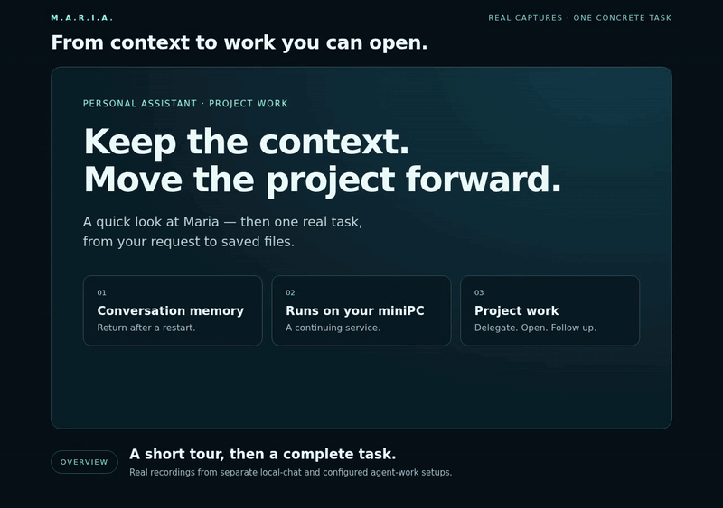

<p align="center">
  
  <h1 align="center">M.A.R.I.A.</h1>
  <p align="center"><b>Meta Analysis Recalibration Intelligence Architecture</b></p>
  <p align="center">
    A personal assistant with persistent memory, voice conversation, and explicit project delegation.<br>
    Local components, with optional external model and project services.
  </p>
  <p align="center">
    <a href="https://github.com/erykaitools-beep/Maria/actions/workflows/test.yml"></a>
    
    
    
  </p>
</p>

---

## See Maria in action

**One request → a project agent → files you can open → a follow-up on the result.**
In this 77-second demo, Maria delegates a three-player game playtest plan through
Kritaqo, then reads the completed report without starting another job.

[](docs/demo/2026-10-22/maria-context-to-action-en.mp4)

**[Full demo — MP4, 77 seconds](docs/demo/2026-10-22/maria-context-to-action-en.mp4)**
· [Still preview](docs/demo/2026-10-22/maria-demo-poster.png)
· [Generated files and recording notes](docs/demo/2026-10-22/README.md)

Real execution in a fictional project; waiting is shortened. English captions,
Polish interface, no audio. The project-work segment uses configured **Kritaqo
and OpenAI Codex**; the local Ollama memory excerpt is a separate capture.

**[Try local chat →](QUICKSTART.md)** Start with the steps below.
The demonstrated project workflow needs additional setup, including deployment
adapters that are not bundled in the public repositories; see
[voice and project integration requirements](docs/VOICE_AND_PROJECTS.md).

---

## Start with local chat

Linux, Python 3.10+, and a running [Ollama](https://ollama.com/download) with an
installed chat model are required. If you choose `llama3.1:8b` and do not already
have it, download it deliberately with `ollama pull llama3.1:8b` first.

```bash
git clone https://github.com/erykaitools-beep/Maria.git
cd Maria
python3 scripts/start_chat.py --model llama3.1:8b
```

Open **http://127.0.0.1:5000** and enter the PIN printed in the terminal. The
launcher creates `.venv-chat` and a private `.env` only when missing, installs
core dependencies, and starts local chat without background learning or project
execution. It does not install/start Ollama or download models. Existing
configuration is preserved; use a separate clone alongside an established
installation. macOS and Windows have not been validated for this path.

**[Quick start and troubleshooting](QUICKSTART.md)** covers model preparation,
`--port`, `--prepare-only`, persistence, and the separate full-daemon option.

---

## Screenshots

<p align="center">
  
  <br><em>Status Dashboard — system health, mode, goals, knowledge stats</em>
</p>

<p align="center">
  
  <br><em>Status Dashboard — planner, experiments, model registry</em>
</p>

<p align="center">
  
  <br><em>Decision Traces — episode-based cognitive traceability</em>
</p>

---

## What is Maria?

Maria is a **personal digital companion** running as a Python daemon with a browser interface. Conversation memory, operator preferences, task receipts, and reports survive individual model calls. Background learning and autonomous reasoning are configurable, not prerequisites for a conversation.

She remembers who you are, what you care about, and adapts to your preferences.

You can use local Ollama chat or configure an optional Codex backend. Local speech recognition uses an externally installed whisper.cpp model. Codex, remote project hosts, Telegram, and other enabled integrations have their own connectivity and account requirements; not every configuration is offline.

### Current interaction guide

See **[Voice, conversation, and projects](docs/VOICE_AND_PROJECTS.md)** for setup and limitations:

- Foreground conversation: say “Maria” once, finish an utterance with about four seconds of audio silence, and follow up without repeating the name during a three-minute idle-listening window.
- Bounded spoken introductions, with the complete reply retained in chat and an explicit full readout.
- Durable chat request receipts and recovery without automatically resending an uncertain request.
- Optional Kritaqo project selection, task cards, existing reports, recorded checks, and explicit new-work requests across configured hosts.

This repository is a curated source snapshot. Runtime data, credentials, model weights, external project repositories, and device-specific configuration are not included. Registered shared projects are not arbitrary discovered folders, and a completed agent report is not independent verification of its files or a human test.

> **New here?** Start with **[local chat](QUICKSTART.md)**. Voice, external
> project services and autonomous operation are optional, separately configured
> capabilities; the quick-start launcher does not enable them.

### Other runtime profiles

The full daemon can retain perception, memory, learning, and deterministic
background actions according to its configuration. `lean` shortens model
residency; it does not by itself disable background reasoning. Review
`MARIA_BACKGROUND_REASONING`, `MARIA_WARMUP`, `MARIA_TELEGRAM_INTEGRATION` and
`MARIA_CONDUCTOR_INTEGRATION` before choosing that runtime. The local-chat
launcher applies its own narrower process settings and does not stop previously
authorized work running elsewhere.

Optional Codex chat requires a separately installed, compatible, authenticated
Codex runtime and a model available to the account. Its configured failures are
reported without silently switching the turn to Ollama. The selected model is
not provider attestation, and changing it grants no new tools. This optional
backend belongs to the separately configured runtime, not `start_chat.py`.

### Key Features

| Feature | Description |
|---------|-------------|
| **Autonomous Learning** | Drop `.txt` files in `input/` — Maria chunks, extracts knowledge, runs spaced repetition exams |
| **Cognitive Core** | 13 architectural contracts (K1-K13): perception, goals, planning, world model, meta-cognition |
| **Self-Reflection** | Self-analysis, creative tension detection, experiment system for parameter tuning |
| **Proactive Communication** | Morning summaries, goal achievements, idle check-ins via Telegram |
| **Operator Memory** | Remembers your name, interests, schedule, preferences across sessions |
| **Web UI** | Chat, status dashboard, knowledge browser, experiment viewer |
| **Telegram Bot** | Two-way communication, approve/reject goals, remote control |
| **Vision** | Optional camera integration for scene understanding (`gemma3:4b`, on-demand behind a scene-change gate) |

### Architecture Overview

```
                    ┌─────────────────────────────────────┐
                    │          Homeostasis Loop (1Hz)       │
                    │  sense → interpret → validate → act   │
                    └──────────────┬──────────────────────┘
                                   │
        ┌──────────┬───────────┬───┴────┬──────────┬──────────┐
        │          │           │        │          │          │
   ┌────┴────┐ ┌───┴───┐ ┌────┴───┐ ┌──┴──┐ ┌────┴────┐ ┌───┴────┐
   │ Percept.│ │ Goals │ │Planner │ │World│ │Creative │ │Teacher │
   │  (K1)   │ │ (K3)  │ │ (K5)   │ │Model│ │ (K13)   │ │ Agent  │
   └─────────┘ └───────┘ └────────┘ │(K6) │ └─────────┘ └────────┘
                                     └─────┘
        ┌──────────┬───────────┬───────────┬──────────┐
        │          │           │           │          │
   ┌────┴────┐ ┌───┴───┐ ┌────┴────┐ ┌────┴───┐ ┌───┴────┐
   │Autonomy │ │Safety │ │  Meta-  │ │ Self-  │ │Experim.│
   │  (K7)   │ │(K10)  │ │Cognit.  │ │Analysis│ │ (K11)  │
   └─────────┘ └───────┘ │  (K9)   │ │ (K12)  │ └────────┘
                          └─────────┘ └────────┘

   ┌─────────┐ ┌─────────┐ ┌─────────┐ ┌─────────┐
   │Telegram │ │ Web UI  │ │ Vision  │ │Semantic │
   │  Bot    │ │ (Flask) │ │(camera) │ │ Memory  │
   └─────────┘ └─────────┘ └─────────┘ └─────────┘
```

### Cognitive Contracts (K1-K13)

| Layer | Contracts | Purpose |
|-------|-----------|---------|
| **Perception** | K1 Unified Perception | Event aggregation from all sources |
| **Boundary** | K2 Sandbox | Isolated learning, promote-to-production gate |
| **Planning** | K3 Goals, K5 Planner, K8 Deliberation | Goal system, ReAct loop, multi-step strategies |
| **Knowledge** | K6 World Model, K9 Meta-Cognition | Belief system, confidence tracking, assumptions |
| **Safety** | K7 Autonomy, K10 Action Safety | Action classification, rate limiting, audit log |
| **Growth** | K11 Experiments, K12 Self-Analysis, K13 Creative | Parameter tuning, reflection, tension detection |

## Documentation

| Topic | Document |
|---|---|
| **Local installation** | [QUICKSTART.md](QUICKSTART.md) |
| **Voice, conversation, and project work** | [docs/VOICE_AND_PROJECTS.md](docs/VOICE_AND_PROJECTS.md) |
| **Glossary of terms** | [GLOSSARY.md](GLOSSARY.md) |
| **Troubleshooting & FAQ** | [TROUBLESHOOTING.md](TROUBLESHOOTING.md) |
| Architecture & data flow | [docs/ARCHITECTURE.md](docs/ARCHITECTURE.md) |
| Cognitive contracts (K1–K13) | [docs/CONTRACTS.md](docs/CONTRACTS.md) |
| Security posture | [docs/SECURITY.md](docs/SECURITY.md) |
| Development status (per-subsystem maturity) | [docs/SYSTEM_STATUS.md](docs/SYSTEM_STATUS.md) |
| Funding & hardware research | [docs/funding/](docs/funding/) |
| Hardware benchmark plan | [docs/funding/HARDWARE_BENCHMARK_PLAN.md](docs/funding/HARDWARE_BENCHMARK_PLAN.md) |

## Running Maria

**Start here:** [QUICKSTART.md](QUICKSTART.md) prepares and runs local chat with
an existing Ollama model. Python dependencies need Internet on first setup;
model weights are downloaded only through a command you run separately. Chat
history and request receipts persist in `maria_ui/data/`, with conversation and
operator-related state in `meta_data/`. Preserve both directories and `.env`.

### Advanced: full daemon and learning

The full runtime is optional. Review `install.sh`, `.env.example` and the
[advanced quick-start section](QUICKSTART.md#advanced-the-full-daemon) before
using it. The legacy installer can install/start Ollama, pull chat and embedding
models, and install the full dependency set. It keeps an existing `.env`, but is
not a non-mutating upgrade tool. The daemon uses `venv/`; the chat launcher uses
its separate `.venv-chat/`.

When background learning is explicitly enabled in the full daemon, text files
in `input/` can be processed by its planner. This does not happen in chat-only
mode. Dashboard counters and health labels are not substitutes for testing the
specific model or integration you configured.

## Configuration

Core settings are in `.env` (created by the chat launcher or legacy installer). Optional integrations also require external runtimes and private configuration; see the [current interaction guide](docs/VOICE_AND_PROJECTS.md).

| Variable | Default | Description |
|----------|---------|-------------|
| `MARIA_PIN` | *(random)* | Web UI login PIN |
| `OLLAMA_BASE_URL` | `http://localhost:11434` | Ollama API URL |
| `TELEGRAM_BOT_TOKEN` | *(empty)* | Telegram bot token (optional) |
| `TELEGRAM_CHAT_ID` | *(empty)* | Your Telegram chat ID (optional) |
| `NVIDIA_NIM_API_KEY` | *(empty)* | NVIDIA NIM API key (optional, for stronger analysis) |

### Optional: Telegram Bot

1. Create a bot via [@BotFather](https://t.me/BotFather)
2. Get your chat ID via [@userinfobot](https://t.me/userinfobot)
3. Add to `.env`:
   ```
   TELEGRAM_BOT_TOKEN=your_token
   TELEGRAM_CHAT_ID=your_chat_id
   ```
4. Restart Maria

Commands: `/status`, `/goals`, `/approve`, `/reject`, `/learn`, `/remind`, `/help`

### Optional: Systemd service for the full daemon

This is an advanced daemon deployment, not the local-chat launcher. Prepare its
full environment and configuration first; do not point the service at
`.venv-chat` without reviewing the different requirements.

`scripts/maria.service` is a template — open it and set `User=` and the absolute paths to match your clone, then:

```bash
sudo cp scripts/maria.service /etc/systemd/system/
sudo systemctl daemon-reload
sudo systemctl enable --now maria
```

## How Maria Works

### The Tick Loop

The full daemon runs a 1Hz homeostasis loop; the local-chat launcher does not:

```
SENSE → INTERPRET → VALIDATE → DECIDE → ACT → HEALTH → PERCEIVE → PLANNER → TELEGRAM → REMINDERS → PROACTIVE
```

The **mode regulator** manages four states: `ACTIVE` → `REDUCED` → `SLEEP` → `SURVIVAL`, based on system resources and health.

### Learning Pipeline

```
input/*.txt → chunk → LLM extract → knowledge_index.jsonl → exam → spaced repetition
```

Maria decides **what** to learn based on knowledge gaps, spaced repetition schedule, semantic novelty, and operator hints.

### Proactive Contact

Maria reaches out via Telegram when she has something meaningful to say:
- **Morning summary** (7-9am) — health, goals, learning stats
- **Evening recap** (8-9pm) — what happened today
- **Goal achieved** — celebration when a goal is completed
- **Goal proposed** — a new goal is awaiting your approval
- **Idle check-in** — after 48h without operator contact

Quiet hours (23:00-6:00), daily limits, per-reason cooldowns.

## Running in Production

Maria has a production deployment history starting in February 2026. Services restart during updates; persistence, rather than one immortal process, carries state between runs. The following deployment details and counters describe the historical August 2026 snapshot, not a fresh installation or a current benchmark.

| | |
|---|---|
| **Hardware** | AMD Ryzen 5 7430U (6c/12t, CPU-only — no NPU, no discrete GPU) · 32 GB RAM · 1 TB system SSD (~100 GB provisioned) + 6 TB external archival · Ubuntu 22.04 |
| **Deployment** | `maria.service` under systemd, auto-restart on failure |
| **Resource ceiling** | `MemoryHigh=16G`, `MemoryMax=20G`, `OOMPolicy=kill` (systemd drop-in, hard-capped after an incident — see below) |
| **Archival storage** | 6 TB external USB disk (ext4) for rotated logs and daily summaries |

Live counters as of 2026-08-04 (~24 weeks in):

| Signal | Count |
|---|---|
| Knowledge entries | 1,365 |
| Beliefs | 2,000 — **at the cap**, not a total (`MAX_CURRENT_BELIEFS`; pruning decides what survives) |
| Semantic vectors (bge-m3, 1024-dim) | 10,000 — **at the cap** (`MAX_VECTORS`), oldest evicted first |
| Decision traces (episode-correlated) | 4,194 (rotated; older traces are archived) |
| Test suite | 7,262 passing · 4 skipped · ~180s runtime |

> These counters are historical. The [funding status document](docs/funding/CURRENT_PROJECT_STATUS.md) also contains dated observations. Neither is a live counter or a performance guarantee for this revision.

Observed modes: `ACTIVE` most of the day, `REDUCED` briefly during LLM inference spikes, `SLEEP` during low-activity hours, `SURVIVAL` never triggered in production.

## Incidents & Lessons Learned

Real issues from production, and what we did about them. Every fix below is in the commit history.

### 2026-04-17 — The 1.5M-line JSONL

**Symptom.** Nine-hour freeze. Swap exhausted. The watchdog kept restarting the process; every restart hung in the same place.

**Cause.** `beliefs.jsonl` is an append-only log. Confidence decay, revisions, and dedup had accumulated **~1.5 million tombstone rows (1.1 GB)**. On startup, `BeliefStore` replayed the whole file into memory. Compaction had a cadence rule that required a "quiet period" to kick in — but the system was never quiet, because the log was what made it un-quiet. A deadlock in slow motion.

**Fix.**
- Forced compaction on startup when the file exceeds a size threshold
- systemd drop-in: `MemoryHigh=16G`, `MemoryMax=20G`, `OOMPolicy=kill` — a hard ceiling so a runaway replay gets killed fast instead of thrashing swap for hours
- Audit cron every 4 days that surfaces anomalies before they freeze the loop

**Lesson.** An append-only log needs a compaction trigger that **doesn't depend on the system being healthy**. If the hang caused by the log is what prevents compaction, you have a deadlock.

### 2026-04-16 — Confidence feedback loop

**Symptom.** `ConfidenceTracker` reported 0.01 on every action type. Maria effectively stopped trying — every `LEARN` was gated out by low confidence.

**Cause.** The scoring function used `outcome_match` directly: `mismatch → 0.0`. That conflated two distinct signals — *"did we predict right?"* and *"did the action succeed?"*. Learn actions on small/empty topics produced `outcome_match=mismatch` with `actual_success=True` (the action ran fine; we just underestimated). Each such reflection pushed confidence down. Once floored, every subsequent learn was also a "mismatch" relative to the (now-zero) expectation. Floor sealed shut.

**Fix.** Separated the signals. `actual_success` is the primary score. `outcome_match='partial'` halves it. Pending reflections fall back to neutral. (Commit `e1f753d`.)

**Lesson.** When a signal drives a control loop, make sure it measures the thing the loop is reacting to — not a proxy. Proxies are fine until they drift, and control loops amplify drift.

### 2026-04-18 — BeliefBuilder cold-build hang

**Symptom.** After a month-long silent bug in `BeliefBuilder` was fixed, a rebuild unlocked ~7,766 queued topic concepts. The first cold rebuild hung for several minutes and pegged a core.

**Cause.** `BeliefStore.add()` enforces a 2,000-entry cap per call. On a cold rebuild of ~22 k concepts, cap enforcement ran 22 k times — each pass scanning the store.

**Fix.** Wrapped the three build passes in `store.bulk_mode()` — cap enforcement runs once at the end instead of per-add. Multi-minute hang became seconds. (Commit `3a3925e`.)

**Lesson.** Per-item invariants are cheap per call and pathological in bulk. If a path can be called with a large batch, offer a bulk mode that defers the invariant.

## Project Structure

```
maria/
├── maria.py              # Entry point (daemon + Web UI)
├── main.py               # REPL interface (interactive)
├── install.sh            # Quick install script
├── agent_core/           # Core cognitive modules
│   ├── homeostasis/      # 1Hz tick loop, sensors, mode regulation
│   ├── planner/          # ReAct planning loop (K5)
│   ├── goals/            # Goal system with audit trail (K3)
│   ├── teacher/          # Autonomous learning agent
│   ├── consciousness/    # Personality, dreams, user profile
│   ├── creative/         # Tension detection, meta-goals (K13)
│   ├── world_model/      # Belief system (K6)
│   ├── meta_cognition/   # Reflection, confidence (K9)
│   ├── autonomy/         # Action classification, rate limits (K7)
│   ├── action_safety/    # Audit log, effect validation (K10)
│   ├── experiment/       # Parameter tuning system (K11)
│   ├── self_analysis/    # Self-reflection via LLM (K12)
│   ├── semantic/         # Embedding-based memory (bge-m3)
│   ├── telegram/         # Telegram bot integration
│   ├── vision/           # Camera/vision (optional)
│   ├── llm/              # LLM routing, model registry
│   ├── reminders/        # Time-triggered notifications
│   ├── web_source/       # Wikipedia + RSS content fetcher
│   └── tests/            # Isolated tests; see CI for this revision
├── maria_ui/             # Flask Web UI
│   ├── templates/        # HTML (Jinja2)
│   └── static/           # CSS + JS
├── docs/                 # Architecture, contracts, specs
└── scripts/              # Install, backup, systemd
```

## Development

```bash
# Run all tests
source venv/bin/activate
python -m pytest agent_core/tests/ -q

# Run specific module tests
python -m pytest agent_core/tests/test_planner.py -v

# Interactive REPL
python main.py
```

## Tech Stack

| Component | Technology |
|-----------|-----------|
| **Runtime** | Python 3.10+, threading |
| **LLM** | Configurable Ollama chat, optional Codex chat; other subsystem providers are separate |
| **Web UI** | Flask + Flask-SocketIO, vanilla JS |
| **Storage** | JSON, JSONL, and SQLite (including durable chat turn receipts) |
| **Embeddings** | bge-m3 (1024-dim, via Ollama) — replaced nomic-embed-text 2026-07-25 |
| **Communication** | Telegram Bot API |
| **Tests** | pytest and browser JavaScript fixtures; optional dependencies and device acceptance are separate |

The Flutter Android client is maintained separately. Its sources and APK are not part of this repository. A prepared Android release still requires physical-device microphone/TTS acceptance; mocked tests are not that evidence.

## License

[AGPL-3.0](LICENSE) — Copyright (C) 2025-2026 Eryk (@DonCames)

## Credits

M.A.R.I.A.'s production deployment history began in **February 2026**.

Built by Eryk with help from Claude, ChatGPT, and Grok.
