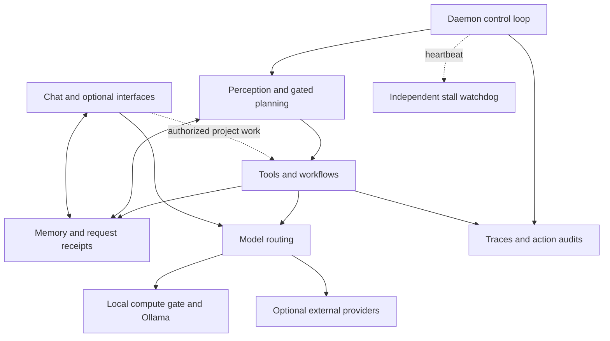

# M.A.R.I.A.

A production-oriented autonomous agent runtime built in Python, designed for long-running operation, local models, observable decision-making, and recovery on resource-constrained hardware.

## For recruiters — 60-second overview

M.A.R.I.A. connects a persistent assistant, a configurable background agent, and
explicitly authorized project work. It is a personal deployment and engineering
portfolio, with inspectable code, regression tests, and documented failures.

### Existing demo: from request to saved files

[](https://raw.githubusercontent.com/erykaitools-beep/Maria/main/docs/demo/2026-10-22/maria-context-to-action-en.mp4)

**[Watch or download the existing 77-second demo](https://raw.githubusercontent.com/erykaitools-beep/Maria/main/docs/demo/2026-10-22/maria-context-to-action-en.mp4)**
· [Recording notes and output files](docs/demo/2026-10-22/README.md)
· [German portfolio summary and CV text](docs/portfolio-summary-de.md)

The recording shows a request delegated through configured **Kritaqo and OpenAI
Codex**, a completed job producing `PLAYTEST.md` and `RESULTS.csv`, opening the
saved artifact, and a follow-up that reads the result without creating another
job. A separate local Ollama excerpt shows conversation context after a demo-app
restart. These implemented paths demonstrate task handoff, persistence and
result retrieval—the engineering a recruiter can inspect beyond a chat reply.

The project is fictional; execution and generated files are real. Waiting is
shortened, captions are English, the UI is Polish, and there is no audio. The
results sheet has **zero result rows**: the human playtest has not happened.
This selected successful workflow is not a latency or reliability benchmark;
the recording notes disclose failed wording trials. Full project execution
requires deployment adapters outside this repository. The [Quick start](#quick-start)
provides local text chat.

### Engineering overview

| Question | Evidence-backed answer |
|---|---|
| What works? | Local browser chat, durable request receipts, conversation memory, a daemon control loop, goal planning, action policies, bounded memory stores, and decision traces. Optional integrations require separate configuration. |
| Deployment hardware | Ryzen 5 7430U miniPC, 32 GB-class RAM, integrated graphics; no discrete GPU detected. Host observations are dated **26 October 2026**. |
| Tests | **8,164 passed** per Python job on 3.10, 3.11 and 3.12; **4 skipped, 1 xpassed**, plus **140 passing subtests**. [Public CI, 22 October 2026](https://github.com/erykaitools-beep/Maria/actions/runs/39823011497). |
| Reliability work | Caller and HTTP timeouts, an independent watchdog, non-blocking workflow advancement, stale-goal cleanup, and persistent request identity. [Four incident analyses](docs/production-reliability-case-study.md). |
| Technologies | Python, threading, Ollama, Flask/Socket.IO, JSON/JSONL, SQLite, pytest, JavaScript tests, systemd; optional external model and project services. |
| Relevance to the role | AI/Applied AI: model integration and evaluation boundaries. Agentic Systems: action governance and task continuity. AI Automation: deployment, debugging, recovery and inspectable outputs. |

## Why this project exists

An assistant that runs for days faces problems that a single model call does
not: stalled network requests, expensive background work, memory growth,
duplicate submissions, interrupted tasks and misleading health signals.
M.A.R.I.A. is a working environment for investigating those problems on a small
machine, with state that outlives an individual process.

The focus is the surrounding software: deciding when work may run, keeping a
record of what happened, exposing uncertainty, and recovering when a component
fails. Long-term research ideas remain in the documentation, with their
[implementation status distinguished from runtime features](docs/runtime-guide.md).

## System architecture



The tactical planner selects actions through deterministic rules; selected
actions may call a model. K1–K13 identify architectural contracts, not separate
model agents. The full daemon has a nominal one-second tick and **21 numbered
top-level phases**, with additional subphases and different subsystem cadences.
This is a scheduling structure, not a real-time latency guarantee.

Source entry points: [launcher](maria.py), [control loop](agent_core/homeostasis/core.py),
[planner](agent_core/planner/planner_core.py), [action policy](agent_core/autonomy/__init__.py),
[memory query](agent_core/memory/query.py), and [chat receipts](maria_ui/chat_turns.py).
The chat-only launcher does not start this full daemon.

## Production evidence

Evidence is scoped to public source revision `47eaec0` and a dated operator-host
observation. The running private installation can differ from the public
snapshot. [Audit, methods and exclusions](docs/evidence/portfolio-audit-2026-10-26.md)
record that distinction.

| Measurement or constraint | Verified value | Source / verification |
|---|---|---|
| Full Python CI suite | 8,164 passed; 4 skipped; 1 xpassed; 140 passing subtests **per Python version** | [Completed CI run](https://github.com/erykaitools-beep/Maria/actions/runs/39823011497), job logs; repeated matrix runs are not added together. |
| Minimal chat setup | 24 passed + 16 subtests in its separate CI job | [CI configuration](.github/workflows/test.yml); Ollama fixture, no real-model quality claim. |
| Browser protocol tests | 3 passed, 0 failed per Node step | Same CI run and configuration; synthetic browser fixtures. |
| Operator host | Ryzen 5 7430U; 30.77 GiB OS-visible RAM in the documented 32 GB configuration; integrated AMD display controller only | [Sanitized observation](docs/evidence/portfolio-audit-2026-10-26.json): CPU inventory, `/proc/meminfo`, PCI enumeration. |
| Daemon memory policy | `MemoryHigh=16G`, `MemoryMax=20G`, `OOMPolicy=kill` | Host systemd properties agree with cgroup limits. The high value is a pressure threshold; the max value is the hard limit. These host settings are **not included** in the [service template](scripts/maria.service). |
| Memory retention bounds | 2,000 current beliefs; 10,000 vectors | [BeliefStore](agent_core/world_model/belief_store.py), [VectorStore](agent_core/semantic/vector_store.py). Caps, not measured current occupancy or total learned knowledge. |
| Demo output | 1 completed job, 2 files, no new job on the result follow-up | [Recording provenance](docs/demo/2026-10-22/EVIDENCE.json), [file hashes](docs/demo/2026-10-22/SHA256SUMS.txt); selected demonstration, not a success-rate estimate. |

Production here means an operator-run deployment with maintenance and restarts.
There is no measured availability SLO or claim of uninterrupted uptime since
February. Process presence alone does not establish successful autonomous work.

## Reliability and failure handling

- **Persistent state and shutdown:** planner state, task stores and chat receipts
  survive process boundaries. The launcher attempts a session checkpoint and
  module cleanup; the control loop flushes buffered events. This is not a
  transaction covering every file or a guarantee of lossless crash recovery.
- **Bounded work:** [execution budgets](agent_core/llm/execution_budget.py)
  separate caller deadlines from HTTP timeouts. Workflow steps have configured
  [retry limits and failure policies](agent_core/workflow/workflow_engine.py).
  An uncertain chat request is retained as `unknown`, not silently resubmitted.
- **Independent recovery:** the watchdog runs outside the tick thread, dumps
  stacks on a stall, and exits so a configured systemd service can restart it.
  The planner's stale-goal reaper releases blocked goal slots; it is a separate
  mechanism from process recovery.
- **Resource control:** participating local inference paths share a
  [compute coordinator](agent_core/llm/local_compute.py), with thermal cooling
  and [model residency management](agent_core/llm/model_scheduler.py).
  Serialization limits concurrent demand but cannot preempt running inference.
- **Observable actions:** [episode IDs](agent_core/tracing/episode.py), action
  audits and persisted outcomes connect a decision to its execution. Self-repair
  detects selected failures and creates operator alerts; acknowledgement closes
  the task. It does not autonomously patch production source code.

See the [case study](docs/production-reliability-case-study.md) for causes,
regression tests, and the remaining failure modes.

## Local model operation

Local chat accepts an explicitly selected installed Ollama chat model. The
[daemon registry](agent_core/llm/model_registry.py) configures `llama3.1:8b`,
`qwen3:8b`, and `qwen2.5-coder:7b` for different roles; semantic retrieval uses
`bge-m3` embeddings with 1,024 dimensions. The demo's separate memory capture
used `qwen2.5:3b`. Registry entries are not proof that every model is installed
or resident, and 8B is a configured model size, not a universal capacity limit.

CPU inference trades accelerator independence for latency. Model choice,
quantization, context length and concurrent system work affect memory and
response time; larger models do not automatically justify their resource cost.
Idle unloading reduces residency but adds cold-start latency. Embeddings and
vision also consume the local compute budget.

Optional NIM, Codex and project services have separate account and connectivity
requirements. The browser currently loads Socket.IO from a CDN, so even local
inference does not make the complete installation offline. The `lean` profile
reduces residency; background reasoning needs its own explicit setting.

## Testing strategy

Tests cover deterministic policy and state transitions, persistence and restart
receipts, fault injection for timeouts, workflow scheduling, memory maintenance,
and a local-chat integration path with a synthetic Ollama server. Node fixtures
exercise browser voice, work and polling protocols.

Use a separate checkout and test environment, away from a running installation:

```bash
python3 -m venv .venv-test
source .venv-test/bin/activate
python -m pip install -r requirements.txt pytest-timeout
python -m pytest agent_core/tests/ -q --tb=short -x --timeout=60
node --test agent_core/tests/test_chat_voice.mjs agent_core/tests/test_chat_work.mjs agent_core/tests/js/test_polling.cjs
python scripts/doc_lint.py
```

The [workflow](.github/workflows/test.yml) records the full CI commands. The
[audit](docs/evidence/portfolio-audit-2026-10-26.md) also records this documentation
review's smaller local checks. Passing counts include neither a real-model
quality evaluation nor proof of live network integrations, microphone behavior,
long-duration stability or recovery under every hardware failure. Skips,
unexpected passes and warnings remain visible in the evidence.

## Known limitations

- Full project execution in the demo depends on external deployment adapters;
  a fresh clone does not reproduce the entire workflow. Natural-language project
  routing still has documented failures.
- Background learning and optional integrations depend on configuration. Symbolic
  and predictive modules are research code; procedural skills are a library
  without full planner integration. Their presence is not a delivered capability.
- Caller timeouts cannot cancel arbitrary worker code. The legacy Ollama-client
  fallback can lose the HTTP timeout if timeout-aware client construction fails.
- Stored confidence is a heuristic, not factual correctness. Memory pruning
  trades retained history for bounded size; not every state writer is atomic.
- The UI is primarily Polish. Windows/macOS quick-start acceptance, physical
  phone/voice acceptance and a repeatable real-model quality/latency benchmark
  remain incomplete. Dependencies are not fully locked.
- This is a single-host personal deployment, with no demonstrated multi-tenant
  isolation, high-availability cluster or audited service-level objective.

## Quick start

On **Linux with Python 3.10+**, prepare a running
[Ollama installation](https://ollama.com/download) and an installed chat model.
The example uses `llama3.1:8b`; download it separately with
`ollama pull llama3.1:8b` if needed, or select a smaller installed chat model.

```bash
git clone https://github.com/erykaitools-beep/Maria.git
cd Maria
python3 scripts/start_chat.py --model llama3.1:8b
```

Open `http://127.0.0.1:5000` and enter the PIN printed in the terminal. The launcher
creates `.venv-chat`, installs core dependencies and creates `.env` only when
missing. It preserves existing configuration, starts local text chat and keeps
background learning/project execution disabled for this process. It does not
install Ollama or download model weights. First setup needs Internet access.

Keep the terminal open; Ctrl+C stops this chat process. Preserve `.env`,
`maria_ui/data/` and `meta_data/` for chat continuity, and keep them private.
Use [Quickstart and troubleshooting](QUICKSTART.md) for another port and
first-run checks, or the [runtime guide](docs/runtime-guide.md) for the separate
full-daemon setup, configuration and screenshots.

[Documentation map](docs/README.md) · [Reliability case study](docs/production-reliability-case-study.md)
· [German portfolio](docs/portfolio-summary-de.md) · [Security](docs/SECURITY.md)
· [Contributing](CONTRIBUTING.md) · [AGPL-3.0 license](LICENSE)

Built by Eryk with AI-assisted development using Claude, ChatGPT and Grok.
